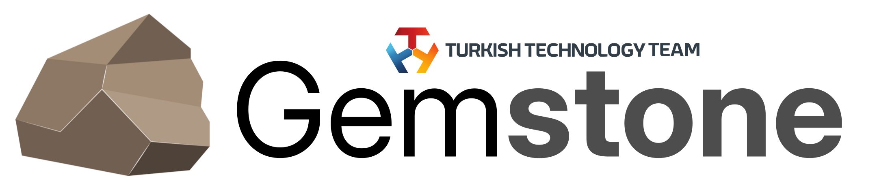

<p align="center">
    <picture>
        <source media="(prefers-color-scheme: dark)" srcset=".meta/logo-dark.png" width="40%" />
        <source media="(prefers-color-scheme: light)" srcset=".meta/logo-light.png" width="40%" />
        
    </picture>
</p>

# T3 Gemstone SDK

 [](https://www.t3vakfi.org/en) [](https://docs.t3gemstone.org) [](https://opensource.org/licenses/Apache-2.0) [](https://github.com/89luca89/distrobox) [](https://www.jetify.com/devbox/docs/contributor-quickstart/)

## What is it?

This project includes all the necessary work for compiling the operating system, kernel, and other tools found on T3 Gemstone boards, and is intended for developers who wish to prepare a customized GNU/Linux Distribution.

All details related to the project can be found at https://docs.t3gemstone.org/en/sdk. Below, only a summary of how to perform the installation is provided.

##### 1. Install Docker and jetify-devbox on the host computer.

```bash
user@host:$ ./setup.sh
```

<a name="section-ii"></a>
##### 2. After the installation is successful, activate the jetify-devbox shell to automatically install tools such as Distrobox, taskfile, etc.

```bash
user@host:$ devbox shell
```

##### 3. Download the repositories, create a Docker image, and enter it.

```bash
📦 devbox:sdk> task fetch
📦 devbox:sdk> task permissions
📦 devbox:sdk> task box
```

##### 4. Build the Yocto recipes and Gemstone distro.

```bash
# Show all available tasks and environment variables
🚀 distrobox:workdir> task default

# Build kernel, bootloader, initrd
# Note: MACHINE can be 'intel-corei7-64', 't3-gem-o1', 'beagley-ai' or 'qemuarm64'
# Note: First build takes approximately 2 hours and you need at least 32GB empty disk space
🚀 distrobox:workdir> task yocto:build MACHINE=intel-corei7-64

# Build the PowerVR GPU userspace (TI mesa-pvr)
# Note: only 't3-gem-o1' for now; required by its task distro:build
# Note: takes a few minutes
🚀 distrobox:workdir> task graphics:build MACHINE=t3-gem-o1

# Pack Distro
# Note: DISTRO_BASE can be 'ubuntu', 'debian', 'pardus'
# Note: DISTRO_SUITE can be 'jammy', 'bookworm', 'yirmiuc', 'yirmibes'
# Note: DISTRO_TYPE can be 'minimal', 'kiosk', 'desktop', 'tablet'
🚀 distrobox:workdir> task distro:build MACHINE=intel-corei7-64 DISTRO_TYPE=desktop DISTRO_BASE=ubuntu DISTRO_SUITE=jammy IMG_SIZE=16G

# Pack Pardus Tablet
🚀 distrobox:workdir> task distro:build MACHINE=intel-corei7-64 DISTRO_TYPE=tablet DISTRO_BASE=pardus DISTRO_SUITE=yirmibes IMG_SIZE=16G

# After build images, run virtual machine
🚀 distrobox:workdir> task yocto:runqemu MACHINE=intel-corei7-64 DISTRO_TYPE=desktop DISTRO_BASE=ubuntu DISTRO_SUITE=jammy WORKDIR=$PWD
```

### Screencast

[](https://asciinema.org/a/KDwPPlCV2wxzpwDB4sLseW2X9)

# GPU Acceleration (T3 Gemstone O1)

The AM67A SoC carries a PowerVR Rogue GPU. Its kernel driver (`pvrsrvkm`), firmware and closed IMG userspace libraries are installed by the SDK, but the piece that connects them to OpenGL ES — Mesa's `pvr_dri.so` — only exists in TI's patched Mesa. Without it GLES silently falls back to `llvmpipe`, the software rasterizer.

`task graphics:build` cross compiles that Mesa against the target rootfs ABI and installs it into an **isolated prefix**, `/opt/ti-gpu`. The image's own Mesa, its Xorg session and its desktop stay on the stock software path; only applications that opt in use the GPU. Opting in is a wrapper:

```bash
gemstone@t3-gem-o1:$ gem-gpu-info                                  # where the render path stands
gemstone@t3-gem-o1:$ gem-gpu-run kmscube                           # any EGL/GBM program
gemstone@t3-gem-o1:$ gem-gpu-run env QT_QPA_PLATFORM=eglfs ./app   # a Qt application
```

Rendering goes through EGL + GBM/DRM, so it needs DRM master: stop Xorg first, or use a VT that Xorg is not holding. GLX (`glxinfo`, indirect X11 rendering) stays on the system Mesa by design — TI's Mesa is built without GLX.

### Kiosk session backend

Because there is no GLX, an Xorg kiosk session renders on the CPU whatever else is installed. The kiosk image instead runs the application straight on DRM/KMS with no display server, selected by `KIOSK_BACKEND` in `/etc/gemstone/kiosk.conf`:

| | `x11` | `eglfs` (default on t3-gem-o1) |
|---|---|---|
| Session | Xorg + openbox | none, the app owns the panel |
| Toolkits | any | Qt only |
| Qt Quick / QML | software | **GPU** |
| native EGL/GL | software | **GPU** |
| QtWidgets | works | **black screen** — driver bug, see below |

The example kiosk application (`~/bin/kiosk`) is Qt Quick for this reason. Measured on a T3 Gemstone O1, same application on the 1024x600 DSI panel, 4x Cortex-A53 @1.4 GHz:

| | App CPU | Xorg CPU | App RSS |
|---|---|---|---|
| `x11` — llvmpipe | 82% | 3.0% | 130 MB |
| `eglfs` — PowerVR | **7%** | — | 62 MB |

The toolkit is the same in both rows, so that difference is the GPU. For reference the previous QtWidgets version of the example cost 74% under `x11`; moving to Qt Quick is what makes the GPU reachable, not what makes it cheap.

**The QtWidgets caveat:** under `eglfs` a QtWidgets window stays black. Qt reports no error — it selects the mode correctly and keeps flipping buffers — but the texture it uploads from the widget backingstore never reaches the screen. The same application renders correctly under llvmpipe, so the fault is in the PowerVR userspace, not in Qt's configuration. Set `KIOSK_BACKEND=x11` for a QtWidgets application, or for anything that is not Qt.

# Configuration of Kernel and U-Boot

```bash
# Initialize bitbake
🚀 distrobox:workdir> source yocto/poky/oe-init-build-env build/intel-corei7-64

# Tune Linux Kernel
🚀 distrobox:intel-corei7-64> bitbake -c menuconfig virtual/kernel

# Tune U-Boot
🚀 distrobox:intel-corei7-64> bitbake -c menuconfig virtual/bootloader
```

# Troubleshooting

#### 1. First Installation of Docker

Docker is installed on your system via the `./setup.sh` command. If you are installing Docker for the first time, you must log out and log in again after the installation is complete.

#### 2. Debos Segmentation Fault Error

When you perform the compilation process with the task:distro command many times, debos may occasionally give a "Segmentation Fault" error. 

Additionally, following error can occur while compiling the arm64 image for BeagleY-AI. This problem persists even after rebooting your system, so you may need to apply the solution after each reboot.

```sh
W: Failure trying to run:  /sbin/ldconfig
qemu: uncaught target signal 11 (Segmentation fault) - core dumped
```

To solve these problems, first try running the following command inside [devbox shell](#section-ii)

```bash
📦 devbox:sdk> distrobox stop gemstone-sdk
```

if it does not work, run the destroy command.

```bash
📦 devbox:sdk> task destroy
```

#### 3. Yocto Issues

```bash
# Stop distrobox
📦 devbox:sdk> distrobox stop gemstone-sdk

# Start and Enter distrobox image
📦 devbox:sdk> task box

# Clean yocto image
🚀 distrobox:workdir> task yocto:build MACHINE=intel-corei7-64 TARGET='-c clean -c cleansstate gemstone-image-rd virtual/kernel'

# Rebuild
🚀 distrobox:workdir> task yocto:build MACHINE=intel-corei7-64
```

#### 4. Failed `task box` command

```sh
📦 devbox:sdk> task box
task: Failed to run task "box": exit status 1
Error: An error occurred
```

To figure out what exact problem is, run `distrobox-enter --additional-flags "--tty" --name gemstone-sdk --no-workdir --verbose`

```sh
*** update-locale: Error: invalid locale settings:  LC_ALL=en_EN.UTF-8 LANG=en_EN.UTF-8
```

To solve this problem, try to update locales

```bash
📦 devbox:sdk> sudo dpkg-reconfigure locales 
```
